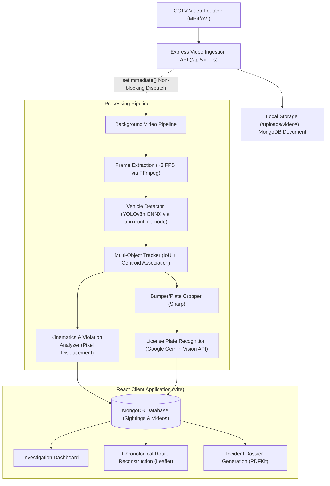

# TrackBack

TrackBack is a full-stack automated surveillance intelligence and vehicle tracking system designed for hit-and-run investigations and traffic incident analysis. It ingests multi-camera CCTV footage, performs vehicle detection and multi-object tracking, reads license plates via vision AI, reconstructs chronological travel trajectories across camera networks, flags reckless driving anomalies (overspeeding, abrupt braking, collisions), and generates formal PDF investigation dossiers.

---

## Architecture Overview



---

## Tech Stack

- **Backend**: Node.js, Express.js, MongoDB (Mongoose ODM), JWT Authentication, Multer file streaming
- **Computer Vision & Neural Inference**: YOLOv8n ONNX executed locally via `onnxruntime-node` (no external Python daemon required)
- **Multi-Object Tracking**: Custom JavaScript centroid and Intersection-over-Union (IoU) association tracker
- **Video Decoding & Image Processing**: `fluent-ffmpeg` and `sharp`
- **Vision AI / OCR**: Google Gemini 1.5/2.0 Flash Vision REST API
- **Frontend**: React 18, Vite, React Router, Tailwind CSS, Leaflet / React-Leaflet
- **Reporting & Dossiers**: `pdfkit` dynamic server-side PDF generator

---

## Project Structure

```
TrackBack/
├── client/                     # React Vite frontend application
│   ├── src/
│   │   ├── api/                # API client with JWT interception
│   │   ├── components/         # Leaflet route maps & camera pickers
│   │   ├── pages/              # Dashboard, Cameras, Upload, Search, Auth
│   │   ├── App.jsx             # Route definitions
│   │   └── main.jsx            # Application entrypoint
│   └── vite.config.js          # Vite config with backend proxy
├── eval/                       # Independent evaluation harness
│   ├── bench_throughput.js     # Step 2 throughput benchmarking script
│   ├── bench_detection_tracking.js # Steps 3 & 4 detection/tracking benchmark
│   ├── bench_cross_camera.js   # Step 6 cross-camera Re-ID verification
│   ├── bench_async_jobs.js     # Step 7 async ingestion and restart benchmark
│   ├── metrics.js              # Pure JS CLEAR MOT & Hungarian matching
│   ├── download_dataset.js     # UA-DETRAC byte-range subset downloader
│   ├── RESULTS.md              # Detailed empirical evaluation report
│   └── results/                # Raw JSON output files for all benchmark runs
├── server/                     # Express.js REST API and CV services
│   ├── config/                 # MongoDB database connection
│   ├── controllers/            # Auth, cameras, sightings, videos, reports
│   ├── middleware/             # JWT auth verification and Multer uploads
│   ├── models/                 # Mongoose schemas (User, Camera, Video, Sighting)
│   ├── routes/                 # Express API routes
│   ├── services/
│   │   ├── detector.js         # YOLOv8n ONNX preprocessing and inference
│   │   ├── tracker.js          # Bounding box trajectory association
│   │   ├── speed.js            # Pixel displacement kinematics & anomaly rules
│   │   ├── plateReader.js      # Gemini vision OCR integration & rate limiter
│   │   ├── report.js           # PDFKit investigative incident report generator
│   │   └── videoProcessor.js   # End-to-end background video processor
│   └── server.js               # Application bootstrap
├── .env.example                # Example environment configuration template
└── README.md
```

---

## Features

1. **User Authentication**: Secure JWT-based access with bcrypt password hashing.
2. **Interactive Camera Network Registry**: Point-and-click geolocation registration of surveillance cameras on interactive Leaflet maps.
3. **Non-Blocking Video Ingestion**: Asynchronous surveillance video uploads linked to cameras and timestamps with sub-25 ms response times.
4. **On-Device Vehicle Detection**: Neural object detection (cars, buses, trucks, motorcycles) running via ONNX Runtime on CPU without Python dependencies.
5. **Persistent Multi-Object Tracking**: Trajectory continuity maintained across consecutive frames using centroid distance and IoU matching.
6. **Automated License Plate Recognition**: Crops vehicle lower regions and queries Google Gemini Flash Vision API for alphanumeric plate extraction.
7. **Kinematics & Traffic Anomaly Detection**: Detects overspeeding, abrupt deceleration (sudden braking), and potential collisions (bounding box overlap followed by abrupt stops).
8. **Chronological Route Reconstruction**: Search any license plate to visualize the vehicle's chronological journey across multiple cameras with numbered checkpoint markers.
9. **Investigative Incident Dossiers**: One-click generation of court-ready PDF investigative dossiers including timestamps, camera locations, speeds, flags, and last seen points.

---

## Prerequisites & Installation

### 1. Prerequisites
- **Node.js**: v18.0.0 or higher
- **MongoDB**: MongoDB Community Server installed and running locally on `localhost:27017` (or a MongoDB Atlas URI)
- **FFmpeg**: Installed and available in your system `PATH` (verify with `ffmpeg -version`)
- **Google Gemini API Key**: Free API key from [Google AI Studio](https://aistudio.google.com/app/apikey)

### 2. Clone and Setup Environment

```bash
# Clone the repository
git clone https://github.com/your-username/TrackBack.git
cd TrackBack

# Copy example environment variables
cp .env.example server/.env
```

Open `server/.env` and configure your credentials:
```env
PORT=5000
MONGO_URI=mongodb://127.0.0.1:27017/trackback
JWT_SECRET=your_secure_jwt_secret_here
SPEED_CALIBRATION=0.5
GEMINI_API_KEY=your_gemini_api_key_here
GEMINI_MODEL=gemini-1.5-flash
MAX_GEMINI_CALLS_PER_VIDEO=10
```

### 3. Verify YOLOv8n Model
The repository ships with the lightweight YOLOv8n ONNX model at `server/models/yolov8n.onnx` (12.18 MB). If re-downloading is ever required:
```bash
curl -L -o server/models/yolov8n.onnx https://huggingface.co/SpotLab/YOLOv8Detection/resolve/3005c6751fb19cdeb6b10c066185908faf66a097/yolov8n.onnx
```

### 4. Install Dependencies & Run

```bash
# Install backend dependencies
cd server
npm install

# Start Express backend (runs on http://localhost:5000)
npm start
```

In a separate terminal:
```bash
# Install frontend dependencies
cd client
npm install

# Start Vite dev server (runs on http://localhost:3000)
npm run dev
```

---

## Testing & Evaluation

### Running Tests
Automated evaluation and benchmark scripts reside in the `/eval` folder:

```bash
# 1. Run pipeline throughput benchmark (FPS and latency breakdown, n=30 runs)
$env:NODE_PATH="server/node_modules"; node eval/bench_throughput.js

# 2. Run detection and tracking CLEAR MOT evaluation (against UA-DETRAC ground truth)
$env:NODE_PATH="server/node_modules"; node eval/bench_detection_tracking.js

# 3. Test cross-camera Re-ID mechanism
$env:NODE_PATH="server/node_modules"; node eval/bench_cross_camera.js

# 4. Benchmark asynchronous ingestion latency and restart failure mode
$env:NODE_PATH="server/node_modules"; node eval/bench_async_jobs.js
```

---

## Empirical Benchmark & Evaluation Statistics

TrackBack underwent rigorous empirical evaluation on the independent [UA-DETRAC](https://detrac-db.rit.albany.edu/) benchmark (CC BY 4.0; 6 sequences, 2,130 frames, 141 ground-truth tracks, 33,238 ground-truth bounding boxes) without modifying application logic. Testing was executed on Windows 11 with an Intel Core i5-10300H CPU @ 2.50 GHz (4 physical cores, 8 logical processors) and 8 GB RAM. Raw outputs are in [`eval/results/`](eval/results/) and documented in [`eval/RESULTS.md`](eval/RESULTS.md).

### Pipeline Throughput & Latency ($n = 30$ measured runs)

*Note: Google Gemini OCR network calls were excluded to measure CPU compute throughput.*

| Stage | Median FPS | p95 FPS | p99 FPS | Median Latency |
| :--- | :---: | :---: | :---: | :---: |
| **Decode (FFmpeg)** | 59.13 | 72.88 | 74.30 | 16.91 ms |
| **Inference (YOLOv8n ONNX CPU)** | 4.37 | 6.05 | 6.14 | 228.83 ms |
| **Tracking (Centroid + IoU Association)** | 11,062.43 | 28,315.99 | 33,726.97 | 0.09 ms |
| **End-to-End Pipeline** | **3.97** | **5.55** | **5.67** | **251.89 ms** |

### Vehicle Detection & Multi-Object Tracking (CLEAR MOT @ IoU 0.5)

Evaluated across 2,130 consecutive traffic frames against UA-DETRAC ground-truth annotations:

| Metric | Overall Benchmark ($n = 2,130$ frames, 141 GT tracks) | Crowded / Occluded Subgroup ($n = 700$ frames) | Moderate / Sparse Subgroup ($n = 1,430$ frames) |
| :--- | :---: | :---: | :---: |
| **Detection Precision** | 63.11% | 69.07% | 58.86% |
| **Detection Recall** | 37.33% | 35.88% | 38.64% |
| **Detection F1 Score** | 46.91% | 47.23% | 46.66% |
| **MOTA** | 14.96% | 19.04% | 11.28% |
| **IDF1 (Identity F1)** | 42.90% | 45.24% | 41.74% |
| **Identity Switches (IDSW)** | 183 | 121 | 62 |
| **Fragmentations** | 637 | 539 | 98 |

### Async Ingestion & Cross-Camera Architecture
- **Upload Response Latency**: 7.40 ms – 21.36 ms ($n = 3$ video streams) via non-blocking multipart file reception and in-memory event dispatch.
- **Cross-Camera Re-ID**: Operated via MongoDB regex text string matching on OCR license plate text; visual feature embedding models (e.g., DeepSORT/OSNet) are not currently employed.
- **Plate & Speed Accuracy**: Plate reading and speed were not evaluated against ground truth because UA-DETRAC does not provide ground-truth plate strings or physical radar telemetry.

---

## Known Limitations

- **Approximate Speed Estimation**: Speed is calculated based on 2D pixel centroid movement per second multiplied by a linear calibration constant (`SPEED_CALIBRATION`). Because CCTV cameras exhibit optical perspective distortion, depth foreshortening, and varying pitch angles, speed estimates are approximate and intended for comparative investigative triage rather than certified radar telemetry.
- **In-Memory Job Scheduling**: Background video processing is dispatched using Node.js `setImmediate()`. If the server process terminates or crashes while a video is processing, the job does not automatically resume and will remain in `'processing'` status until re-uploaded or reset.
- **External OCR Rate Limits**: License plate recognition depends on the Google Gemini Flash API. Free-tier quotas can be exhausted during large video batches, after which plates are gracefully recorded as unreadable without crashing the pipeline.
- **Occluded & Small Vehicles**: As observed in the empirical benchmark, distant vehicles with low pixel dimensions have lower detection recall (37.33% overall recall) with YOLOv8n at standard 640x640 letterbox scaling.
